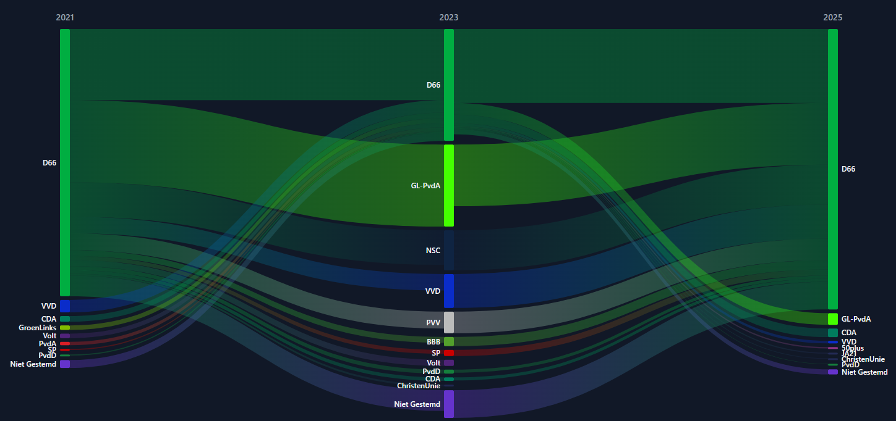

# Dutch Voter Movement Visualization

This project visualizes how voter support moves between Dutch parties across election cycles. It was created after the
2025 Dutch parliamentary election, when media narratives around D66 suggested that voters from many parties had shifted
toward the party. The project asks a broader question: how do those flows actually look across multiple elections, and
how much of the apparent change is real movement versus a continuation of existing support from two elections earlier?

The NOS visualizations focus on one party for one election at a time, which makes it difficult to see the full picture.
This project puts the flows for every party and several elections side by side. The example below shows D66's movement
from 2021 to 2025:

To put the Dutch results in perspective, the app also covers the United Kingdom, Germany and Sweden.

**Try it:** [zoeium.github.io/Dutch-Voter-Movement-Visualization](https://zoeium.github.io/Dutch-Voter-Movement-Visualization/)

## What the app shows

- **Voter movements:** where each party's voters came from and went to between elections, for all parties at once or
  focused on a single party. Available for the Netherlands, the only country with voter movement data so far.
- **Turnout:** for every election, how the electorate splits into valid votes, blank and invalid votes, and people who
  did not vote.
- **Parliament:** how the seats in parliament were divided under each cabinet or government, and how parties merged,
  split and carried their seats over from one to the next.
- **Compare elections:** for any two elections, each party's change in votes, vote share and seats, with the biggest
  gainers and losers highlighted.
- **Coalition explorer:** for each election, which combinations of parties reach a majority of the seats, next to the
  coalition that actually formed after it.

Every view can be shared through its link and exported as an SVG chart or, for comparisons, a CSV file. The app is
available in English and Dutch, in a light and a dark theme.

## The data

The app covers four countries, chosen with the "Election data" selector in the header.

**Netherlands**

- **Election results** for every Tweede Kamer election from 1946 to 2025: electorate, turnout and votes for every
  list that took part, checked against the official results of the Kiesraad (Electoral Council).
- **Voter movements** for the 2021, 2023 and 2025 elections. These come from post-election research such as the Ipsos
  I&O election survey. They are estimates based on polling, not counted votes.
- **Cabinets** from Beel I (1946) to Jetten (2026): the governing parties, any supporting parties, and the seat
  distribution produced by the preceding election.

**United Kingdom**

- **Election results** for every House of Commons general election since the Second World War, from 1945 to 2024,
  including both elections of 1974: electorate, turnout, and votes and seats per party. Small parties are grouped as
  "Other parties". Spoilt ballots are not part of the published national totals, so turnout shows valid votes only.
- **Governments** from Attlee I (1945) to Starmer (2024), including changes of prime minister between elections.
- **No voter movements** are available, so the voter movement diagram is not shown for the United Kingdom.

**Germany**

- **Election results** for every Bundestag election from 1949 to 2025 (West Germany until 1987): party-list votes
  (Zweitstimmen) and seats. Seats before 1990 exclude West Berlin's non-voting delegates.
- **Governments** from Adenauer I (1949) to Merz (2025).

**Sweden**

- **Election results** for every Riksdag election from 1948 to 2026. Until 1968 these are the elections to the second
  chamber; since 1970 the Riksdag has had a single chamber. The 2026 figures are the election-night count.
- **Governments** from Erlander I (1948) to the caretaker government after the 2026 election, including governments
  that continued after an election.

For Germany and Sweden, parties that never won a seat or 1% of the vote are grouped as "other parties", and no voter
movements are available.

Every source is listed in the app itself, under "Sources" at the bottom of the page.

### Data checks

Every change to the data is checked automatically before it is published. Among other things, the checks confirm that
each party's votes add up to the valid votes, that every party has a name and colour, that a cabinet or government
with seats follows every election, and that every governing party actually holds seats.

## Versions

The app is released in numbered versions; the version shown at the bottom of the page is the one you are looking at.
What changed in each version is described in the [changelog](CHANGELOG.md), and every version is available on the
[releases page](https://github.com/Zoeium/Dutch-Voter-Movement-Visualization/releases).

## Notes

This project is primarily a data-visualization and analysis tool rather than a software-first project. A significant
part of the implementation was generated with the help of AI, while the underlying election data and narrative are the
main focus.
